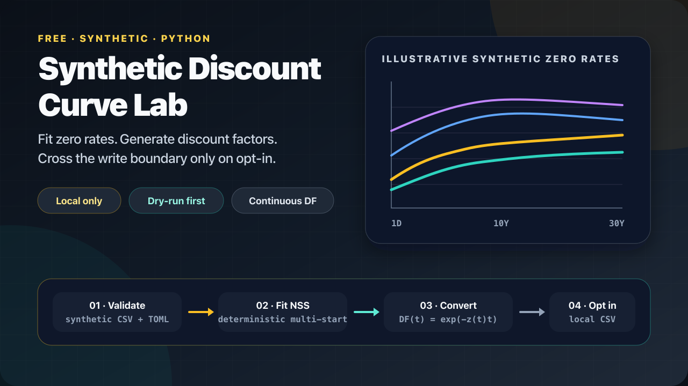
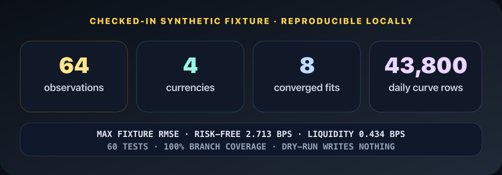
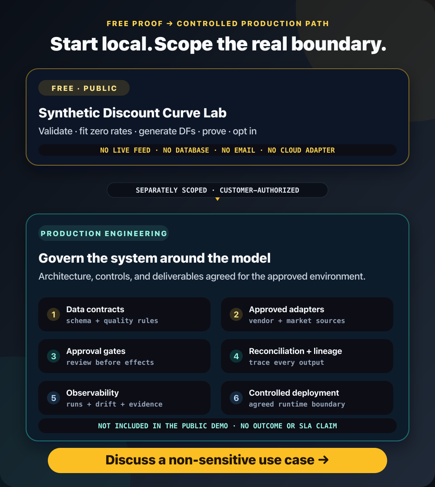

# Synthetic Discount Curve Lab

<p align="center">
  <strong>64 fictional observations → 8 NSS fits → 43,800 daily zero-rate + discount-factor rows.</strong>
</p>



<p align="center">
  <a href="https://github.com/emrekaany/discount-curve-lab/actions/workflows/ci.yml"></a>
  
  <a href="LICENSE"></a>
  <a href="docs/PROVENANCE.md"></a>
</p>

<p align="center">
  <strong>Synthetic · Local only · Dry-run first · No credentials · No network</strong><br>
  <a href="#run-it"><strong>Run the free demo</strong></a> ·
  <a href="https://www.linkedin.com/in/emrekaany/"><strong>Discuss production engineering</strong></a>
</p>

## Run it

From the repository root (Python 3.11+):

```bash
python -m venv .venv && source .venv/bin/activate
python -m pip install .
discount-curve-demo --config config/demo.toml
```

The default command prints JSON fit evidence and writes nothing. Local CSV creation requires `--write-output`; replacing existing files also requires `--overwrite`.



## What you get

For base, +25%, +50% and +100% liquidity-spread scenarios:

`NSS zero rate z(t)` → `discount factor DF(t) = exp(-z(t) × t)`

Rates are decimals, compounding is continuous and year fractions use the configured 365-day denominator.

## From demo to governed production



Need a controlled market-data or curve pipeline?

**Data contracts · approved source adapters · approval gates · reconciliation · lineage · observability · deployment**

<p align="center">
  <a href="https://www.linkedin.com/in/emrekaany/"></a>
</p>

> Educational synthetic demo—not valuation, trading or regulatory software. It does not bootstrap instruments or claim arbitrage-free calibration. Liquidity beyond 10 years is NSS extrapolation.

[Architecture](docs/ARCHITECTURE.md) · [Model references](docs/MODEL_REFERENCES.md) · [Provenance](docs/PROVENANCE.md) · [Public trust](docs/PUBLICATION_SAFETY.md) · [Security](SECURITY.md) · [MIT License](LICENSE)
