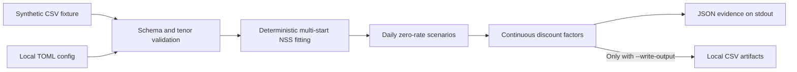

# Architecture

## Goal

Turn small, local term-structure samples into inspectable zero-rate scenarios and explicit
discount factors without connecting to a database, network service, or proprietary dataset.

## Modules

- `model.py`: tenor parsing, NSS evaluation, bounded deterministic fitting, fit metrics, and
  continuous zero-rate-to-discount-factor conversion.
- `pipeline.py`: input validation, curve orchestration, summary generation, and explicit local
  file output.
- `cli.py`: the explicit command boundary. It defaults to dry-run.
- `data/synthetic_market_data.csv`: deterministic fictional values for four currencies.

## Trust boundaries

The runtime has no database, email, HTTP, cloud, or operating-system automation adapter. The
configuration schema deliberately has no host, account, connection string, recipient, or secret
field. A normal invocation reads local files and prints evidence to stdout; it creates no file.

Local persistence crosses two gates:

1. `--write-output` enables CSV creation.
2. If a target exists, `--overwrite` is also required.

All output targets are validated and staged before publication. Existing targets are backed up
during an opted-in overwrite; a publication failure restores the batch. Each file replacement is
atomic on the local filesystem.

The checked-in fixture is trusted demo input; accepting untrusted third-party files requires a
separate input-threat review. Production connectors belong in a private integration layer with
authentication, approval, audit, retry, reconciliation, and rollback controls.

## Model notes

The implementation uses the six-parameter Nelson-Siegel-Svensson function and bounded
multi-start least squares. Rates use decimal representation. Fit evidence is reported as RMSE and
maximum absolute error in basis points. Liquidity estimates are floored at zero when generating
demo scenarios and begin strictly after the configured day threshold; these are product choices,
not universal market conventions.

The output rate `z(t)` is a decimal, continuously compounded zero rate. The matching discount
factor is `DF(t) = exp(-z(t) × t)`, where `t` is the configured day fraction. Published factors are
calculated from the published, rounded maturity and zero-rate values so the CSV contract is
reproducible.

The risk-free fixture reaches 30 years; the liquidity fixture reaches 10 years. Values after the
last observed tenor are NSS extrapolations. The demo does not bootstrap instruments, enforce
no-arbitrage constraints, or provide a production calibration policy.
